# Kaku

**A lightweight typing test for the terminal, written in C.**

Kaku is a command-line typing test designed to help users practice and improve their typing speed and accuracy directly from the terminal.

It supports both custom text input and text files, making it suitable for quick typing exercises as well as longer practice sessions.



## Features

- **Custom text:** Run a typing test using a text string provided through the command line.
- **File-based practice:** Load text from a file and practice its contents line by line.
- **Real-time feedback:** Get visual feedback while typing, distinguishing correct and incorrect characters.
- **Typing statistics:** Track correct and incorrect characters, words and total characters.
- **Elapsed time:** Measure how long each typing test takes.
- **Lightweight:** Built in C with minimal dependencies.

## Requirements

- GCC (or another compatible C compiler).
- GNU Make.
- A POSIX-compatible environment (Linux or macOS).

## Building

Clone the repository:

```bash
git clone https://github.com/Samuel-96/kaku.git
cd kaku
```

Build the project using Make:

```bash
make
```

The executable will be generated in the `build/` directory.

## Usage

### Custom text

Pass a text string using `-t` or `--text`:

```bash
./build/kaku --text "The quick brown fox jumps over the lazy dog."
```

### Text file

Use `-f` or `--file` to load text from a file:

```bash
./build/kaku --file texts/english.txt
```

### Help

Display the available command-line options:

```bash
./build/kaku --help
```

## Project Structure

```text
kaku/
├── include/    # Header files
├── src/        # Source files
├── tests/      # Tests
├── texts/      # Practice texts
├── build/      # Compiled executable
├── Makefile
├── README.md
└── LICENSE
```

## Technologies

- **C** — Core application logic and text processing.
- **GCC** — Compiler.
- **POSIX APIs** — Terminal configuration and keyboard input.
- **Make** — Build automation.

## Project Goals

Kaku is also a personal learning project focused on strengthening my understanding of C and systems programming.

Some of the main areas explored during its development include:

- Modular application design in C.
- Pointers and memory management.
- String manipulation and text processing.
- Command-line argument parsing.
- Terminal input handling and ANSI escape sequences.
- POSIX APIs and time measurement.

## License

See the [LICENSE](LICENSE) file for details.
